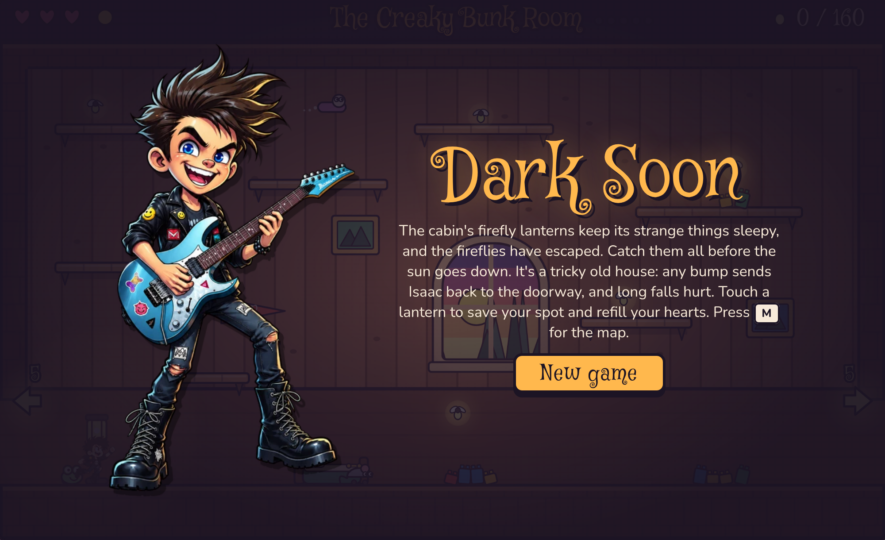
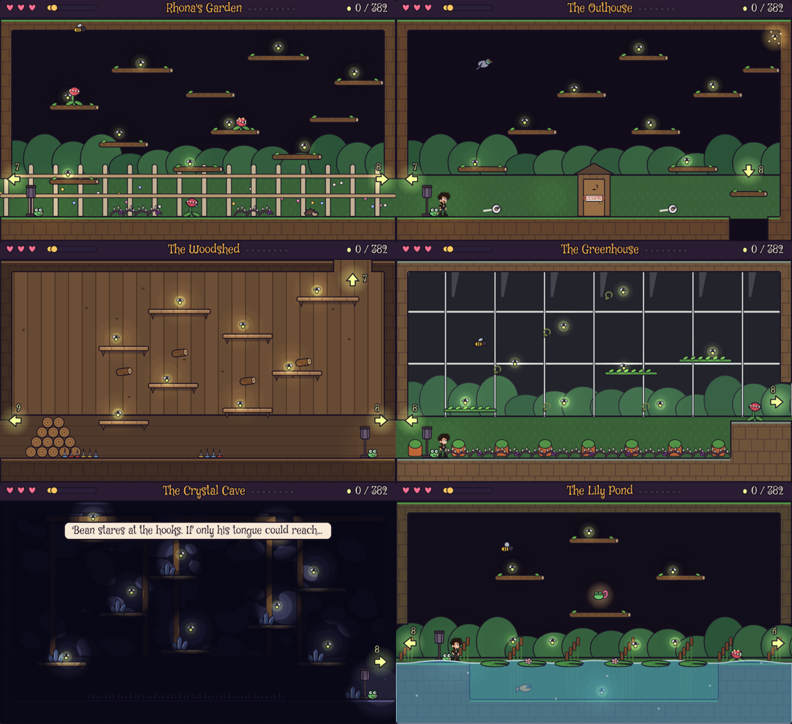

# Dark Soon

A Jet Set Willy style platformer for kids. Isaac and his frog Bean catch the fireflies that escaped around Great-Aunt Rhona's cabin, its cellar, its roof and the woods outside before the sun goes down.

Play it at **[darksoon.com](https://darksoon.com)**.

## Playing

- Arrow keys or WASD to move, Space / Up / W to jump, Down to drop through shelves, M for the map. Touch controls appear on tablets.
- Find Rhona's Umbrella (float), the Slipper Boots (wall jumps) and Bean's Tongue (swing from hooks) to reach new areas.
- Seven brass keys open the Door With Seven Locks.

## Files

- `index.html`: the whole game in one file (canvas, no build step). GitHub Pages serves it as the site.
- `check-rooms.js`: checks that every firefly, item and golden firefly can be reached. Run `node check-rooms.js`; `DUMP="x,y" node check-rooms.js` prints a room map.
- `cabin-map.md`, `concept.md`: the room plan and the game concept.
- `art/`: Isaac's sprite sheets on magenta; `tools/` keys the magenta out.

